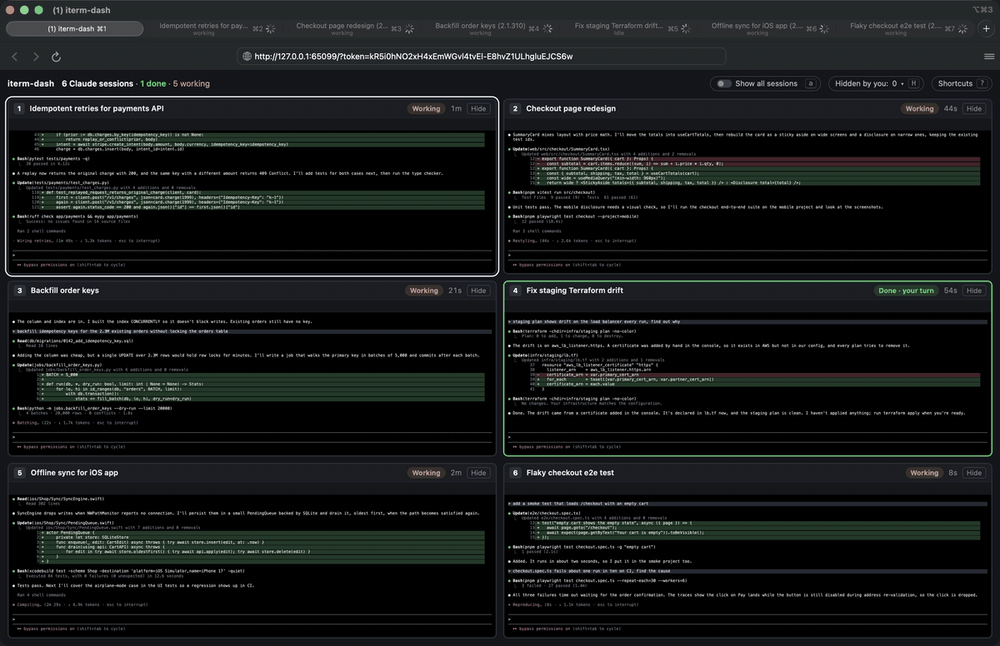
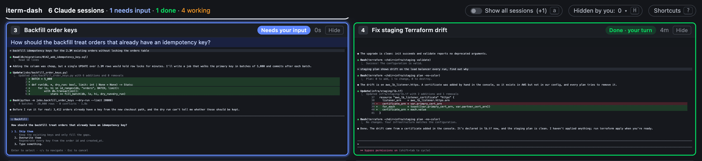
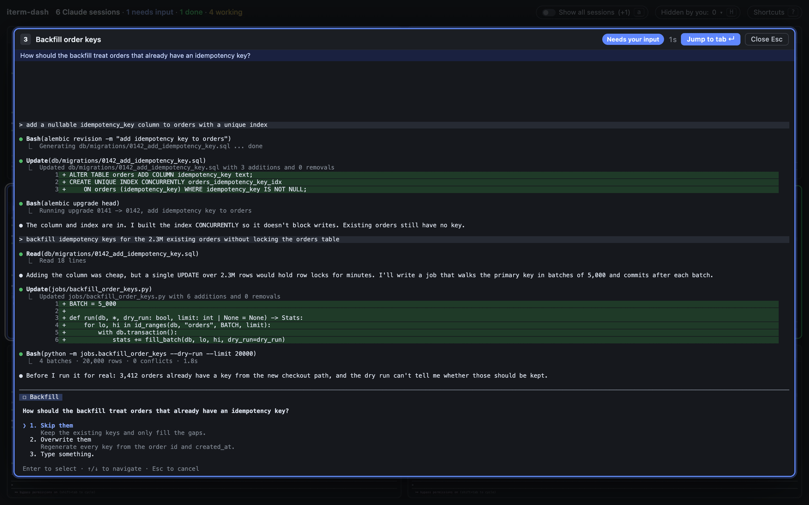

<div align="center">

<h1>iterm-dash</h1>

<p><b>Never leave a Claude waiting.</b></p>

<p>A live, keyboard-driven grid of every Claude Code session you already have open in iTerm2.<br>
Press <kbd>n</kbd> to land in the next one that needs you.</p>

<p>
<a href="https://github.com/ritikrishu/iterm-dash/actions/workflows/ci.yml"></a>
<a href="LICENSE"></a>

</p>

<p><a href="#install">Install</a> · <a href="#how-it-works">How it works</a> · <a href="#faq">FAQ</a> · <a href="docs/architecture.md">Architecture</a></p>



<sub>Recorded with <code>iterm-dash demo</code>, which plays scripted sessions. In real use, <kbd>Enter</kbd> brings that session's iTerm2 tab to the front.</sub>

</div>

## Why

I run eight or nine Claude Code sessions at once, each in its own iTerm2 tab, and two things kept going wrong.

A session would finish, or stop to ask me something, and then sit there until I happened to click past its tab. That's Claude Code time I wasn't using. And every so often I'd cycle through every tab just to glance at each one and check it was still on track, which is tedious with nine of them.

iterm-dash is one more iTerm2 tab that shows all the others live. The sessions that need you light up, and a single key takes you to them.

## What you get

### See who needs you

A session waiting on a question turns blue with **Needs your input** and shows the question under its title. A finished one turns green with **Done · your turn**. Every cell shows how long ago its status changed, so a session that has been waiting a while stands out. The header counts them, and the page title does too, for example `(2) iterm-dash`.



### The real screen, not a summary

Each cell is the session's actual terminal screen at full width, colours and all, scaled to fit and updated as it changes. You can tell a session that's making progress from one that's going in circles without opening it.

### Keyboard first

| Key | Action |
| --- | --- |
| <kbd>n</kbd> | Jump to the next session that needs you: waiting first, then errors, then done |
| <kbd>1</kbd> – <kbd>9</kbd> | Jump to that cell's tab |
| <kbd>←</kbd> <kbd>↑</kbd> <kbd>→</kbd> <kbd>↓</kbd> | Move the focus ring |
| <kbd>Space</kbd> | Peek: enlarge the focused cell (<kbd>Space</kbd> or <kbd>Esc</kbd> closes it) |
| <kbd>Enter</kbd> | Jump to the focused or enlarged cell's tab |
| <kbd>h</kbd> / <kbd>H</kbd> | Hide the focused cell / bring a hidden one back |
| <kbd>a</kbd> | Show every session, not just Claude Code |
| <kbd>-</kbd> <kbd>+</kbd> | Smaller or larger minimum text size |
| <kbd>?</kbd> | Show all shortcuts |

The mouse works too: click a cell to peek, double-click to jump.

### Peek before you jump

<kbd>Space</kbd> opens the focused session full size, so you can read the question or the diff and decide whether it needs you now.



### Works with the tabs you already have

There's no tmux, no wrapper command and nothing to relaunch. Start Claude Code however you like, in any window or tab. iterm-dash finds sessions as they open and close and keeps them in the order it first saw them.

### Read-only by design

iterm-dash never types into, resizes or rearranges your sessions. Apart from managing its own dashboard tab, the only thing it does in iTerm2 is bring a session's tab to the front when you ask.

## Install

**You need** macOS, [iTerm2](https://iterm2.com) 3.7 or later, and [uv](https://docs.astral.sh/uv/). uv installs Python 3.12+ for you if you don't have it.

1. **Turn on iTerm2's Claude Code integration:** choose **iTerm2 › Install Claude Code Integration** and complete at least **Enable Python API** and **Install Hook**. The hook is how each session reports whether it's working, waiting or done.
2. **Install iTerm2's browser plugin,** which lets iTerm2 open a web page as a tab: download [iTermBrowserPlugin-1.0.zip](https://iterm2.com/downloads/browser-plugin/iTermBrowserPlugin-1.0.zip), unzip it and move `iTermBrowserPlugin.app` to `/Applications`. If it's missing, `iterm-dash` tells you so and prints these steps.
3. **Install and run iterm-dash** from any iTerm2 tab:

   ```sh
   uv tool install git+https://github.com/ritikrishu/iterm-dash
   iterm-dash
   ```

The dashboard opens as a new iTerm2 tab. Run `iterm-dash` again at any time to bring it back to the front. The first run takes a few seconds longer while Python compiles, and iTerm2 may ask you to allow the API connection.

<details>
<summary>Other ways to install, and how to uninstall</summary>

With pipx (needs Python 3.12 or later):

```sh
pipx install git+https://github.com/ritikrishu/iterm-dash
```

From a clone:

```sh
git clone https://github.com/ritikrishu/iterm-dash && cd iterm-dash
uv tool install --editable .
```

To update, stop the server and reinstall from the latest commit:

```sh
iterm-dash stop
uv tool install --reinstall git+https://github.com/ritikrishu/iterm-dash
```

To uninstall, stop the server and remove the tool. Settings and logs live in `~/Library/Application Support/iterm-dash/`.

```sh
iterm-dash stop
uv tool uninstall iterm-dash
```

</details>

## Usage

| Command | What it does |
| --- | --- |
| `iterm-dash` | Starts the background server if needed, then opens the dashboard tab or brings it forward |
| `iterm-dash stop` | Stops the background server (and the demo server, if one is running) |
| `iterm-dash smoke` | Read-only check against iTerm2: prints one line of metadata per session (id, title, size, status, fetch time), never screen text |
| `iterm-dash demo` | Starts a demo server with made-up sessions and prints its URL, so you can try the UI without iTerm2 |

The server keeps running until iTerm2 quits or you run `iterm-dash stop`.

## How it works

1. **One background Python process** holds a single connection to [iTerm2's Python API](https://iterm2.com/python-api/).
2. **Screens:** it treats each session's screen stream only as a "something changed" signal, then fetches the raw screen buffer at a throttled rate. Lines are cached by their content, so a changed or scrolled frame only re-renders the lines that are new. Fetching a 214×57 screen takes about 1 ms, and re-rendering a changed frame about 0.5 ms (measured on iTerm2 3.7.6 with Claude Code 2.1.310).
3. **Status** comes from iTerm2's Claude Code integration (`iterm2.get_session_status`), the same source as iTerm2's Session Status tool.
4. **The page** is served on `127.0.0.1` with a per-run token and opened as an iTerm2 browser tab. A WebSocket sends it only the rows that changed, and it renders each screen at full width and scales it to fit the cell. Claude Code ends every row with a hard line break, so text can't be re-flowed into a narrower cell without breaking it.

In the same setup, with several sessions working, the server used about 1% CPU. The full design, including the edge cases that shaped it, is in [docs/architecture.md](docs/architecture.md).

## Privacy and safety

Your terminals hold private work, so iterm-dash is built to keep it on your machine:

- The server only listens on `127.0.0.1`. The page, its WebSocket and its control API all require a random token that changes on every start. Only the page's own JavaScript and CSS are served without it, and they contain no terminal data.
- The dashboard opens as an iTerm2 browser tab, never in your default browser, so that browser's extensions and sync never see your terminal contents or the token URL.
- It makes no outbound network requests and has no telemetry.
- Logs and `iterm-dash smoke` record metadata only (ids, titles, sizes, timings), never screen text.
- It never sends keystrokes to, resizes or closes your sessions.

See [SECURITY.md](SECURITY.md) to report a vulnerability.

## How it compares

- **iTerm2's Session Status tool** (View › Toolbelt › Session Status) lists the same statuses and jumps to a session when you click it. If a status list is enough for you, you don't need iterm-dash. What iterm-dash adds is the live screen, so you can see whether a busy session is on track.
- **Claude Code's agent view** (`claude agents`) manages background sessions and shows a summary per session. Sessions open in other terminals only appear once you background them. iterm-dash shows the sessions you already have, as they are, without changing how you run them.
- **Session managers** such as [claude-squad](https://github.com/smtg-ai/claude-squad), [agent-deck](https://github.com/asheshgoplani/agent-deck) and [ccmanager](https://github.com/kbwo/ccmanager) start and manage agent sessions for you and let you drive them from one place. Choose one of those if you want orchestration. iterm-dash doesn't start, stop or type into anything.

## FAQ

<details>
<summary><b>Does it work with Ghostty, Terminal.app, Warp or tmux?</b></summary>

No. It's built on iTerm2's Python API and browser tabs, so it's iTerm2 only. tmux running inside an iTerm2 tab shows up like any other session, but tmux's `-CC` integration mode isn't supported.
</details>

<details>
<summary><b>Do I need Claude Code?</b></summary>

The live previews work for any iTerm2 session: press <kbd>a</kbd> to show them all. The "needs you" highlighting relies on the status that Claude Code reports through iTerm2's integration, so other tools show up as plain previews.
</details>

<details>
<summary><b>Why not resize sessions to fit the grid?</b></summary>

Resizing a session in iTerm2 resizes its real window. Tabs share one window size, and it fails on full-screen windows. iterm-dash renders each screen at its own width and scales it down instead, so your windows stay exactly as you left them.
</details>

<details>
<summary><b>A session says "Done" but Claude crashed. Why?</b></summary>

Status is reported by Claude Code's hook. If Claude exits uncleanly, the last status can go stale. That's why every cell shows how long ago its status changed. The clock starts when iterm-dash sees the change, so after the server restarts, it counts from the restart.
</details>

<details>
<summary><b>Something isn't working. Where do I start?</b></summary>

- **Every cell says "Status unknown" or nothing ever lights up:** iTerm2's Claude Code hook isn't installed or was dropped. Choose **iTerm2 › Install Claude Code Integration** (or **Reinstall Claude Code Integration**), then restart the Claude Code sessions that were already running.
- **`iterm-dash` can't connect to iTerm2:** turn on the Python API in **Settings › General › Magic**, and run `iterm-dash` from an iTerm2 tab.
- **You closed the dashboard tab:** run `iterm-dash` again. It reopens the tab or brings it forward.
- **Something else:** `iterm-dash smoke` shows what iterm-dash can see, and `server.log` records what it did. Both contain metadata only, so they're safe to paste into an issue.
</details>

<details>
<summary><b>Where are the logs and settings?</b></summary>

In `~/Library/Application Support/iterm-dash/`: `server.log`, `settings.json` (text size and the show-all toggle), `server.json` and `dashboard.json`. Set `ITERM_DASH_STATE_DIR` to use a different folder.
</details>

<details>
<summary><b>Can it answer prompts or send text to a session?</b></summary>

Not in this version, and not by accident. Version 1 is deliberately read-only. Its only action is focusing a tab.
</details>

## Development

```sh
git clone https://github.com/ritikrishu/iterm-dash && cd iterm-dash
uv sync
uv run pytest        # Python tests (no iTerm2 needed)
npm test             # page module tests
uv run iterm-dash demo
```

`iterm-dash demo` serves the real UI fed by scripted sessions, which is how the screenshots above were made. It's the quickest way to work on the page. The tests run against fake sessions, so neither needs iTerm2.

How the code fits together:

| Module | Job |
| --- | --- |
| `backend.py` | iTerm2 API: discovery, screen watchers, status, focus, and the content-keyed line cache |
| `pump.py` | Throttled, latest-only screen fetches |
| `render.py` | Screen lines → styled row runs, plus row diffs |
| `hub.py` | Cached state, and broadcasts changes to open pages |
| `web.py` | Token-guarded routes and the WebSocket |
| `web/app.js` | The grid UI, built on pure modules (`layout.js`, `nav.js`, `clicks.js`, `format.js`, `rows.js`) |
| `server.py`, `cli.py` | Process entry point and the `iterm-dash` command |
| `surface.py` | Opens the iTerm2 browser tab |
| `demo.py` | Scripted sessions for UI work |

Read [CONTRIBUTING.md](CONTRIBUTING.md) before opening a pull request, and [docs/architecture.md](docs/architecture.md) for the design and the iTerm2 behaviour it depends on. There's one hard rule: anything that changes a session gets tested only on a throwaway session, and debug output never prints screen text.

## License

[MIT](LICENSE). iterm-dash is an independent project, not affiliated with Anthropic or iTerm2. Claude and Claude Code are trademarks of Anthropic.
