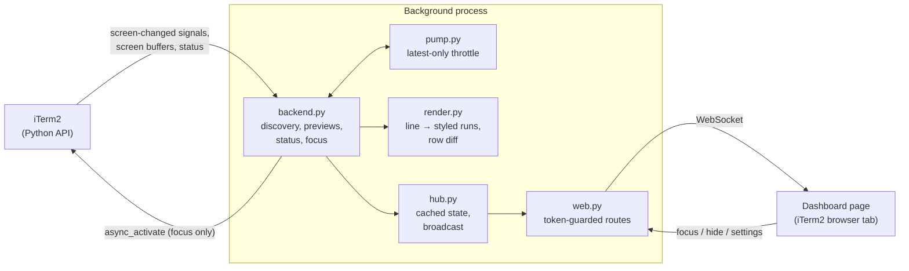

# How iterm-dash works

This is the contributor's view of iterm-dash: what each part does, why it is built the way it is, and the iTerm2 and Claude Code behaviour it depends on. For setup and tests, see [CONTRIBUTING.md](../CONTRIBUTING.md).

## Overview

iterm-dash is one background Python process and one web page.

- The process keeps a single connection to iTerm2's Python API. It discovers sessions, watches their screens and reads their status, and serves the page on `127.0.0.1`.
- The page runs in an iTerm2 browser tab. It draws a live grid of the other sessions, scaled down from their full width, and sends back the few things the user can do: focus a session, hide or unhide a cell, change a setting.



The `iterm-dash` command (`cli.py`) sits outside this loop. It starts the process if it isn't running and asks it to open or bring forward the dashboard tab.

## Modules

| Module | Job |
|---|---|
| `cli.py` | The `iterm-dash` command: `iterm-dash`, `stop`, `smoke`, `demo`. Starts the server detached, checks for the iTerm2 browser plugin, and calls the server's local API. |
| `server.py` | Process entry point. Wires the hub, the backend (live or demo) and the web app, writes `server.json`, and shuts everything down when iTerm2's connection closes or `iterm-dash stop` arrives. |
| `backend.py` | The live iTerm2 backend: discovery, one screen watcher per session, the status loop, palettes, the line cache, and focus. |
| `registry.py` | Lists sessions in iTerm2's order and describes each one (title, job, size, whether it is a Claude session). |
| `pump.py` | `LatestOnlyPump`: runs a fetch at most once per interval and never concurrently; any number of "changed" marks in between collapse into one fetch. |
| `render.py` | Turns one iTerm2 screen line into a row of styled runs (`line_row`), and diffs two frames' rows (`diff_rows`). |
| `palette.py` | Resolves iTerm2 colours (standard, 256-colour, RGB, default) to `#rrggbb` using the session's profile. |
| `status.py` | Maps iTerm2's Claude Code status dict to a dashboard tone and label, and tracks when each session's status last changed. |
| `hub.py` | Holds the latest state (sessions, screens, statuses, hidden cells, settings), sends new pages a full snapshot, and broadcasts changes. |
| `web.py` | The aiohttp app: the page, `/ws`, `/api/health`, `/api/open`, `/api/stop` and static files. Every route except `/static/` checks the token. |
| `surface.py` | Opens the dashboard as an iTerm2 browser tab, or brings the open one forward. |
| `state.py` | State directory, `server.json`, `settings.json`, and private file writes. |
| `demo.py` | Made-up sessions, so the page can be developed and tested without iTerm2. |
| `smoke.py` | A read-only check against real sessions that prints metadata only. |
| `web/` | The page: `app.js` (the grid and its event handling) plus pure, tested modules `layout.js`, `nav.js`, `clicks.js`, `format.js` and `rows.js`. No framework and no build step. |

## Previews

Each watched session has its own pipeline:

1. **Change signal.** `session.get_screen_streamer(want_contents=False)` tells the backend that the screen changed. Its contents are not used; it only marks the session dirty.
2. **Throttled fetch.** A `LatestOnlyPump` (minimum interval 0.25 s, at most one fetch in flight per session) fetches the raw `GetBufferResponse` with `iterm2.rpc.async_get_screen_contents`. A burst of changes becomes one fetch, and the newest screen is always the one fetched. Older frames are never queued.
3. **Content-keyed line cache.** Each line of the response is looked up by its serialized protobuf bytes in the previous frame's cache. Only lines that weren't on the previous frame go through `render.line_row`. Because the key is the content and not the row number, a scrolled screen reuses the rows that moved. The cache holds one frame per session, so it stays bounded, and it is dropped when the palette changes.
4. **Row diff.** The hub compares the new frame with the last one it sent (`diff_rows`) and broadcasts only the changed rows. The first frame, a size change or a colour change sends every row.
5. **Page.** The page patches the changed rows into the cell. One font size applies to the whole grid; `layout.js` picks the number of columns that keeps text at or above the minimum size, and each cell shows the bottom rows that fit, so the latest output and the input box stay visible.

The code deliberately calls `iterm2.rpc.async_get_screen_contents` instead of the higher-level `session.async_get_screen_contents()`, which would build Python objects for every cell and lose the cache.

`render.line_row` emits runs of `[text, fg, bg, flags]`. It merges neighbouring cells with the same style, marks wide characters so the grid stays aligned, drops trailing default-background blanks, and maps never-written cells (see the platform facts below) to spaces.

Colours come from the session's profile and iTerm2's current light or dark theme. A `VariableMonitor` on the app's `effectiveTheme` and the layout monitor both trigger a recolour: palettes are re-read and every session is fetched again.

## Status

iTerm2 ships a Claude Code integration. Its bundled `cc-status` hook is registered for Claude Code's hook events and records each session's state, which any API client can read:

```python
await iterm2.async_invoke_function(conn, 'iterm2.get_session_status(session_id: "<id>")')
```

The result has `status`, `dot_color`, `text_color`, `detail`, `background_tasks` and `turn_open`. `status is None` means the session isn't running Claude.

The backend reads status for every session once a second and again after each preview fetch, and pushes a change to the page as soon as it sees one, separately from the preview throttle. `status.classify` turns the dict into a tone:

| Status | Label | Tone |
|---|---|---|
| `waiting` | Needs your input | loudest |
| `error`, `failed`, or a red dot | Error | loud |
| `idle`, `done` | Done · your turn | loud |
| `working` | Working | quiet |
| any other text | the text itself | quiet |
| none, but a Claude session | Status unknown | quiet |
| none, not Claude | the job name | quiet |

"Time since change" moves only when the tone or label changes. A changed `detail` or colour is still pushed, but it doesn't reset the clock. A failed status read carries no information, so it changes nothing.

Status is self-reported by the hook. If Claude crashes, the last status can go stale, which is why every cell shows how long it has been since the last change.

## Discovery

`registry.list_sessions` walks `app.terminal_windows → tabs → sessions`. A session counts as Claude if it has a status, if its `jobName` looks like a version string, or if its command line starts with `claude`.

A discovery pass runs at start, on iTerm2's `NewSessionMonitor`, `SessionTerminationMonitor` and `LayoutChangeMonitor` events, when a session's status appears or disappears, when a screen's size changes, and every 10 seconds as a safety net (it catches title changes and missed events). Each pass logs what triggered it.

Cells keep the order in which sessions were first seen. A new session gets a cell at the end, and a closed session's cell is removed. Nothing else reorders the grid.

The dashboard's own tab is always excluded. Watching itself would cause a redraw loop. Its session id is saved in `dashboard.json`, so a restarted server excludes it before the first discovery pass and can replace a stale dashboard tab.

## The dashboard tab

iTerm2 3.7 can host a web page in a tab through its browser plugin. `surface.py` opens one with a profile customisation:

```python
p = iterm2.LocalWriteOnlyProfile(values={"Custom Command": "Browser", "Initial URL": url})
tab = await app.current_terminal_window.async_create_tab(profile_customizations=p)
```

- The key is `"Initial URL"`. Setting `"Command"` is ignored for browser sessions, and `LocalWriteOnlyProfile` has no setter for `"Initial URL"`, so it is passed as a raw value.
- The dashboard never opens in the default browser, so that browser's extensions, history sync and session restore never see terminal contents or the token URL. If the plugin is missing, `iterm-dash` prints install steps and exits with status 1.
- Keys reach the page's JavaScript, except ⌘ chords such as ⌘1, which iTerm2 keeps for tab switching.

## Jump

Jumping to a session is the only thing iterm-dash does to another session:

```python
await session.async_activate(select_tab=True, order_window_front=True)
await app.async_activate(raise_all_windows=False, ignoring_other_apps=True)
```

Measured on iTerm2 3.7.6:

| Target window | Result | Time for the calls |
|---|---|---|
| Behind other windows | Comes to the front | about 43 ms |
| Minimised to the Dock | Un-minimises and comes to the front | about 606 ms, mostly the macOS animation |
| On another Space | macOS switches to that Space | about 39 ms, plus the Space animation |

## Security model

The page shows the contents of your terminals, so access to it is guarded:

- The server binds to `127.0.0.1` on a random port and is never reachable from the network.
- Each server run creates a random token (`secrets.token_urlsafe(32)`). The page, the WebSocket and the API routes require it and compare it in constant time. Static assets under `/static/` don't need it; they hold no terminal data.
- The WebSocket also rejects a request whose `Origin` header is present and isn't the server's own `http://127.0.0.1:<port>`.
- `server.json`, which holds the port and token, is written with mode `0600` in a `0700` directory.
- The CLI's requests to the server bypass any configured HTTP proxy.
- The page loads nothing from the network; its scripts and styles come from the local server. Screen text is escaped before it is rendered.
- Logs and debug output carry ids, sizes, counts and timings only. Exceptions are logged by type name, because their messages can contain screen text.

## State and logs

State lives in `~/Library/Application Support/iterm-dash/` (override with `ITERM_DASH_STATE_DIR`):

| File | Contents |
|---|---|
| `server.json` | pid, port, token and mode of the running server |
| `settings.json` | "Show all sessions" and the minimum text size |
| `dashboard.json` | the dashboard tab's session id |
| `server.log` | the server's log (metadata only) |

The demo server uses a `demo/` subfolder, so it never collides with the live one.

The server keeps running until iTerm2 quits or `iterm-dash stop`. That way hidden cells and "time since change" survive closing and reopening the dashboard tab.

## Scope and non-goals

iterm-dash is read-only toward your sessions. Its only action is focus (`async_activate`). It never calls `async_set_grid_size`, `async_send_text` or `async_inject` on a watched session.

Out of scope on purpose:

- **Resizing sessions** (tmux-style "size follows the viewer"). In iTerm2, `async_set_grid_size` resizes the real window, all tabs in a window share one size, and the call fails on full-screen windows.
- **Typing into sessions** or answering Claude from the dashboard.
- **Split-pane layout awareness** and tmux `-CC` integration.

## Verified platform facts

Checked on macOS with iTerm2 3.7.6, Claude Code 2.1.310 and the `iterm2` Python package 2.30.

- **Claude Code ends every screen row with a hard line break.** `LineContents.hard_eol` was true on every line across five sessions. Text can't be re-flowed into a narrower cell, so previews keep the session's full width (for example 214 columns) and scale it down. Cropping to half the width cut off 25–65% of lines.
- **Never-written cells come back as U+0000, not a space.** When Claude Code skips over cleared cells with a cursor move, iTerm2 draws them blank but `string_at` returns `"\x00"`. Browsers drop NUL characters, so `line_row` maps them to spaces; without that, previews lose word gaps and indentation.
- **`jobName` for a Claude session is its version string** (`2.1.310`), not `claude`. That's why detection relies on the status, with the version pattern and command line as fallbacks.
- **Sessions in background tabs still stream.** Each session sends 0–10 screen updates per second.
- **Costs are small.** A styled screen fetch takes about 1 ms at 214×57. A full render of a screen in Python takes about 20 ms, which is why the line cache exists; with it, a changed or scrolled frame costs about 0.46 ms. The server measured about 1% CPU with sessions working.
- **"Needs you" includes finished turns.** With `--dangerously-skip-permissions`, permission prompts are rare, so `idle` (turn finished) and `waiting` both mean the session is waiting on you; `waiting` is the louder of the two.
- **API access.** A process started inside an iTerm2 session connects to the Python API without a prompt. A process started elsewhere has to request a cookie through AppleScript.
- **Resizing isn't safe to automate.** `async_set_grid_size` resizes the user's real window, tabs share one window size, and it fails on full-screen windows.

## Useful references

- The installed `iterm2` package's source has good docstrings and is the most reliable API reference.
- The `it2` CLI (`/Applications/iTerm.app/Contents/Resources/utilities/it2`) helps with debugging. `it2 session get-status --session <id>` prints the same status JSON the dashboard reads.
- iTerm2's own Cockpit (⌥⇧⌘C) is a status list with click-to-jump; iterm-dash adds live previews.
